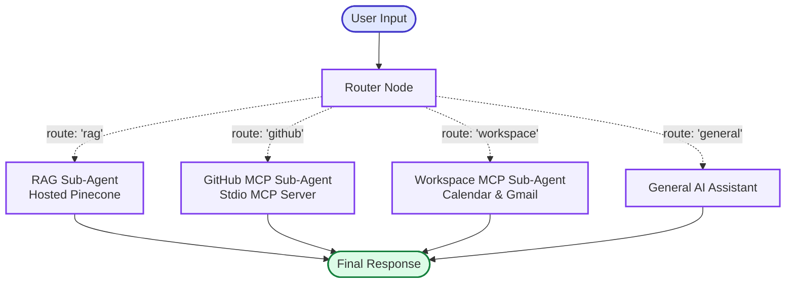

# 🚀 LangGraph Multi-Agent RAG System

[](https://github.com/Mahinn849/langgraph-multi-agent-rag-system)
[](https://www.python.org/)
[](https://github.com/langchain-ai/langgraph)
[](https://www.pinecone.io/)
[-success.svg)](https://modelcontextprotocol.io/)

A production-ready, modular, and enterprise-grade **Multi-Agent Orchestrator** built with **LangGraph**, featuring:
1. **📚 RAG Sub-Agent**: Grounded document Question & Answering over *Agentic AI Roadmap* PDF and custom uploaded documents using **Hosted Pinecone Vector Store** and OpenAI embeddings (`text-embedding-3-small`). Includes dynamic PDF upload via UI and clean text normalization.
2. **🐙 GitHub MCP Sub-Agent**: Direct GitHub repository inspection, commit history analysis, code search, and file viewing using the **Official Model Context Protocol (MCP)** server via `stdio`. Includes persistent background event-loop management.
3. **📅 Google Workspace MCP Sub-Agent**: Intelligent calendar scheduling and email automation using **Composio** (Google Calendar + Gmail):
   - Multi-calendar listing and user confirmation before booking (no blind default to primary).
   - Strict 2-step booking protocol requiring attendee email invitation inquiry.
   - Event creation, listing, and cancellation.
   - Direct email sending (`send_email`), draft email creation (`create_email_draft`), and automatic meeting invitations.
4. **🧠 Main LangGraph Orchestrator**: High-level routing graph coordinating all specialized sub-agents with explicit typed state (`MainState`), structured Pydantic router (`RouteDecision`), conditional edges, and **MemorySaver** persistent multi-turn session memory.
5. **🎨 Modern Minimalist Web UI**: FastAPI application serving a clean, responsive 3-column dashboard with real-time tool connection badges, recent activity feed, and instant PDF upload/indexing.

---

## 🏛️ System Architecture



---

## 🧩 Sub-Agents Breakdown

### 1. RAG Sub-Agent (`agents/rag_agent.py`)
- **Document**: *The Ultimate Roadmap to Learning Agentic AI* (`data/agentic_ai_roadmap.pdf`).
- **Chunking**: `RecursiveCharacterTextSplitter` (chunk_size: 1000, overlap: 150).
- **Embeddings**: OpenAI `text-embedding-3-small` (1536 dimensions).
- **Vector Database**: **Pinecone Serverless** (`langgraph-rag-index`, namespace `agentic-ai-roadmap`).
- **Graph Topology**: `[START] -> [retrieve] -> [generate] -> [END]`.
- **Anti-Hallucination Guardrail**: Strict system prompt that refuses to answer out-of-domain questions if not found in retrieved chunks.

### 2. GitHub MCP Sub-Agent (`agents/github_mcp_agent.py`)
- **Protocol**: Official **Model Context Protocol (MCP)** via `MultiServerMCPClient`.
- **Server**: `@modelcontextprotocol/server-github` launched over `stdio` via `npx`.
- **Tools**: 26 native MCP tools dynamically bound to `gpt-4o-mini` (e.g. `get_file_contents`, `list_commits`, `search_repositories`, `create_issue`).
- **Graph Topology**: `[START] -> [agent] <---> [tools (ToolNode)] -> [END]`.

### 3. Google Workspace Sub-Agent (`agents/calendar_mcp_agent.py`)
- **Platform**: Powered by **Composio** connected accounts for Google Calendar and Gmail.
- **Calendar Capabilities**:
  - `list_user_calendars`: Lists all calendars in user's account with primary indicator.
  - `list_calendar_events`: Retrieves upcoming events with dates, times, and links.
  - `create_calendar_event`: Schedules new appointments with exact timezone support.
  - `delete_calendar_event`: Cancels existing events by ID.
- **Gmail Capabilities**:
  - `send_email`: Writes and immediately delivers an email to any recipient.
  - `create_email_draft`: Composes and saves an email draft in Gmail for review without sending.
  - **Auto-Invitations**: Automatically dispatches a calendar invitation email to meeting attendees upon scheduling.
- **Multi-Calendar Rule**: Never blindly defaults to primary; prompts the user to select which calendar to book if multiple exist.

### 4. Main Orchestrator (`graph/orchestrator.py`)
- **Shared State (`graph/state.py`)**: `MainState(TypedDict)` containing `messages`, `query`, `route`, `route_reasoning`, and `final_answer`.
- **Router Node (`graph/router.py`)**: Uses structured output (`with_structured_output(RouteDecision)`) to classify incoming queries.
- **Conditional Routing**: Dispatches execution dynamically to the appropriate sub-agent node.

---

## 🔄 Concept Comparison: LangGraph vs. OpenAI Agents SDK

| Feature | OpenAI Agents SDK / Swarm | LangGraph Multi-Agent System |
| :--- | :--- | :--- |
| **Execution Model** | Handoff functions returning agent instances | StateGraph with explicit nodes and conditional edges |
| **State Management** | Context variables dictionary passed into runner | Formally typed `TypedDict` or Pydantic state with reducers (`add_messages`) |
| **Control Flow** | Dynamic procedural loop (`runner.run()`) | Declarative graph topology compiled into an executable Runnable |
| **Tool Execution** | Native function calling in agent loop | Dedicated `ToolNode` with configurable error handling (`handle_tool_errors=True`) |
| **Visual Inspection** | Event stream logs | Native Mermaid diagram generation (`app.get_graph().draw_mermaid()`) |
| **Persistence & Checkpointing** | Custom session handlers | Built-in checkpointers (MemorySaver, SqliteSaver, PostgresSaver) |

---

## ⚙️ Installation & Setup

### 1. Prerequisites
- Python 3.10+ (tested with Python 3.12)
- Node.js & npm (for GitHub MCP stdio server)
- Active accounts for:
  - OpenAI (API key)
  - Pinecone (API key & serverless index)
  - GitHub (Personal Access Token)
  - Composio (API key with Google Calendar and Gmail connections)

### 2. Clone & Install Dependencies
```bash
git clone https://github.com/Mahinn849/langgraph-multi-agent-rag-system.git
cd langgraph-multi-agent-rag-system

# Create and activate virtual environment
python -m venv .venv
.\.venv\Scripts\activate   # On Windows
# source .venv/bin/activate # On Linux/macOS

# Install dependencies
pip install -r requirements.txt
```

### 3. Configure Environment Variables
Copy `.env.example` to `.env` and fill in your keys:
```bash
cp .env.example .env
```

`.env` structure:
```ini
# LLM Provider
OPENAI_API_KEY=sk-...

# Hosted Vector Store
PINECONE_API_KEY=pcsk_...
PINECONE_INDEX_NAME=langgraph-rag-index

# GitHub MCP
GITHUB_PERSONAL_ACCESS_TOKEN=ghp_...

# Google Workspace (Composio)
COMPOSIO_API_KEY=ak_...
COMPOSIO_USER_ID=pg-test-...
CALENDAR_CONNECTION_ID=ca_...
GMAIL_CONNECTION_ID=ca_...
```

---

## 🏃 Running the Application

### 1. Minimalist Web UI (FastAPI + Modern Web App)
Launch the web interface inspired by your reference layout:
```bash
python -m uvicorn app:app --port 8000
```
Open **[http://localhost:8000](http://localhost:8000)** in your browser!
- **Minimalist White Theme** with optional Dark Mode toggle.
- **Left Sidebar**: Quick navigation across Chat, Tools, GitHub, Calendar, Gmail, and Knowledge Base (RAG).
- **Interactive Chat**: Real-time conversation stream with sub-agent badges (`📖 RAG`, `🐙 GitHub`, `📅 Calendar`, `✉️ Gmail`).
- **Right Sidebar**: Live connection indicators (`Connected`) and real-time activity feed.

### 2. Interactive Multi-Agent Chat CLI
Start a conversation directly in the terminal where the orchestrator automatically routes each question:
```bash
python main.py
# or
python main.py --interactive
```

### 2. Single Query Mode
Run individual queries directly from the command line:

```bash
# RAG Query
python main.py --query "According to the PDF roadmap, what is the role of Transformer models in Agentic AI?"

# GitHub MCP Query
python main.py --query "Tell me about the repository octocat/Hello-World and its recent commits."

# Workspace Query (Calendar & Gmail)
python main.py --query "Meri Google Calendar mein kitnay calendars hain aur kaunsa primary hai?"

# Gmail Draft Query
python main.py --query "Write a draft email in Gmail to test@example.com about project status."
```

### 3. Display Graph Topology (Mermaid)
```bash
python main.py --diagram
```

### 4. Run Individual Sub-Agent Test Suites
```bash
# Test RAG Sub-Agent (Ingestion, retrieval, zero-hallucination test)
python test_rag.py

# Test GitHub MCP Sub-Agent (MCP stdio protocol, commits, search)
python test_github_mcp.py

# Test Google Workspace Sub-Agent (Multi-calendar, booking, email send, draft)
python test_calendar_mcp.py
```

---

## 📂 Project Structure

```
langgraph-multi-agent-rag-system/
├── .env                         # Real credentials (ignored by Git)
├── .env.example                 # Sanitized environment template
├── .gitignore                   # Ignores .env, .venv, logs, cache
├── requirements.txt             # Pinned project dependencies
├── main.py                      # Interactive multi-agent CLI
├── app.py                       # FastAPI Web Server & API backend
├── test_rag.py                  # RAG test suite
├── test_github_mcp.py           # GitHub MCP test suite
├── test_calendar_mcp.py         # Google Workspace (Calendar + Gmail) test suite
│
├── static/                      # Minimalist White UI Frontend
│   ├── index.html               # 3-column dashboard layout
│   ├── style.css                # CSS variables & dark/light theme
│   └── app.js                   # Real-time chat, upload & status controller
│
├── data/
│   └── agentic_ai_roadmap.pdf   # Ingested primary roadmap PDF
│
├── agents/
│   ├── __init__.py
│   ├── rag_agent.py             # RAG Sub-Agent (Pinecone + Text Normalization)
│   ├── github_mcp_agent.py      # GitHub MCP Sub-Agent (stdio protocol)
│   └── calendar_mcp_agent.py    # Google Workspace MCP Sub-Agent (Composio)
│
└── graph/
    ├── __init__.py
    ├── state.py                 # MainState TypedDict schema
    ├── router.py                # Structured LLM routing node
    └── orchestrator.py          # StateGraph assembly, MemorySaver & conditional edges
```

---

## 🛡️ Security & Best Practices
- **Zero Secret Exposure**: No API keys or tokens are hard-coded in source files or displayed in logs.
- **Cross-Platform Compatibility**: Full UTF-8 reconfiguration on Windows console to avoid encoding errors with PDF characters.
- **Robust Tool Error Handling**: All `ToolNode` instances use `handle_tool_errors=True` to guarantee that external API failures return helpful diagnostic tool messages rather than terminating execution.
